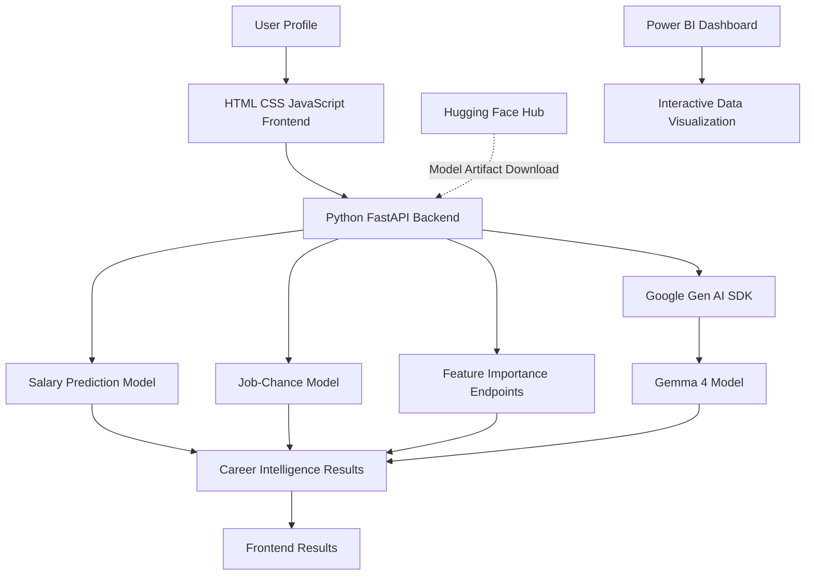

# AI Career Intelligence Engine

**An AI-powered career analytics platform combining Machine Learning, Generative AI, and interactive data visualization.**

[**🚀 Live Demo**](https://delegation-eric-herein-composed.trycloudflare.com/) · [**📊 Power BI Dashboard**](https://app.powerbi.com/view?r=eyJrIjoiOTU3MGZlNGYtOWZjNi00MzIxLWE3YTMtNzQyMmYzN2MwMmNiIiwidCI6IjIxMGY5Y2VjLTRkOWEtNGQ1MS1hYjJmLWMxOTBhNDZiZDg0MCJ9) · [**🤗 Hugging Face Models**](https://huggingface.co/innovatex0/ai-career-intelligence-models)

## Overview

AI Career Intelligence Engine is an educational AI/ML project designed to help students and job seekers make more informed career decisions through data-driven predictions and AI-generated guidance.

The platform combines trained Machine Learning models with Google's Gemma 4 model to deliver salary estimates, job-chance estimates, feature-importance insights, and personalized career recommendations through a FastAPI application.

Instead of providing predictions alone, the project aims to help users understand potential career opportunities and identify areas for improvement.

## Problem Statement

Students and early-career professionals often face uncertainty when choosing career paths, evaluating salary expectations, and identifying the skills required for professional growth.

Traditional career resources may provide general information without combining personalized predictions, model-based insights, and AI-generated recommendations in a single platform.

**Our solution:** Build an integrated career intelligence platform that combines predictive analytics with Generative AI to support more informed career planning.

## Key Features

- **Salary Prediction:** Estimates salary using a trained scikit-learn regression model.
- **Job-Chance Estimation:** Uses a separate trained Machine Learning model to estimate job-related outcomes based on submitted profile information.
- **Feature Importance:** Provides endpoints to inspect features that influence model predictions.
- **AI Career Guidance:** Uses Google's Gemma 4 model through the Google Gen AI SDK to generate career advice based on user-provided profile details.
- **Interactive Frontend:** Provides a web interface for submitting profile information and viewing results.
- **Power BI Dashboard:** Presents career and salary-related insights through interactive visualizations.
- **REST API:** Exposes prediction and career-advice functionality through FastAPI endpoints.
- **Interactive API Documentation:** Supports endpoint inspection and testing through Swagger UI at `/docs`.

## System Architecture

The application follows a frontend–backend architecture that integrates predictive Machine Learning with Generative AI.



### Technology Stack

| Component | Technology | Purpose |
|---|---|---|
| Frontend | HTML, CSS, JavaScript | User interaction and result presentation |
| Backend | Python, FastAPI | Request handling and integration of AI/ML functionality |
| API Server | Uvicorn | Runs the FastAPI application |
| Salary Prediction | scikit-learn | Regression-based salary estimation |
| Job-Chance Estimation | scikit-learn | Model-based job-chance estimation |
| Generative AI | Google Gemma 4 | Personalized career guidance |
| AI Integration | Google Gen AI SDK | Sends prompts to the configured generative model |
| Model Hosting | Hugging Face Hub | Stores and distributes trained model artifacts |
| Data Processing | pandas, NumPy | Data manipulation and numerical operations |
| Analytics | Power BI | Interactive dashboard and data visualization |
| Configuration | Environment variables | Secure configuration of API credentials |

## Why Machine Learning?

Machine Learning enables the platform to estimate career-related outcomes from patterns learned during model training.

The project uses two separate trained models:

**1. Salary Prediction Model**

A regression model estimates salary based on the profile features supported by the trained model.

**2. Job-Chance Model**

A separate model produces a job-related estimate based on the submitted profile and its learned patterns.

These models serve different purposes and are evaluated independently. Their outputs depend on the training data, feature engineering, encoding, and model performance.

The project also exposes feature-importance endpoints to help inspect which input features contribute to the trained models' predictions.

> Model predictions are estimates, not guarantees of salary, employment, or hiring outcomes.

## Why Google Gemma 4?

The project integrates Google's Gemma 4 model for the Generative AI component of the application.

Traditional predictive models return numerical estimates or model-specific outputs. A generative language model can produce natural-language explanations and recommendations that are easier for users to understand.

### How Gemma 4 is used

The application integrates the model through the Google Gen AI SDK. Relevant career-profile information is provided as input to generate career guidance.

Depending on the information supplied and the configured prompt, the intended guidance can include:

- Career development suggestions.
- Skills to consider learning next.
- Areas for professional improvement.
- Recommendations relevant to the user's job role and experience.
- Practical next steps for career planning.

### Why use a separate Generative AI model?

The project separates predictive analytics from language generation:

- **Machine Learning models** estimate salary and job-related outcomes.
- **Gemma 4** generates natural-language career guidance.
- **FastAPI** coordinates requests between the frontend and the relevant backend functionality.

This design combines structured model predictions with conversational AI assistance in one application.

Gemma's recommendations are AI-generated suggestions and should be reviewed rather than treated as guaranteed or authoritative career outcomes.

## How Hugging Face Is Used

The project uses the Hugging Face Hub to host and distribute the trained Machine Learning model files separately from the main GitHub source repository.

**Model repository:** [innovatex0/ai-career-intelligence-models](https://huggingface.co/innovatex0/ai-career-intelligence-models)

### Why Hugging Face?

The trained model artifacts are large binary files. Keeping them separate from the source-code repository helps avoid storing large model files directly in Git and makes model distribution easier to manage.

### Model artifacts

The application retrieves the configured artifacts from the Hugging Face repository:

| Artifact | Purpose |
|---|---|
| `salary_model.pkl` | Trained salary regression model |
| `job_model.pkl` | Trained job-related prediction model |
| `columns.pkl` | Feature-column information for salary prediction |
| `job_columns.pkl` | Feature-column information for the job model |

### Model loading workflow

1. The FastAPI application requests the required model artifacts from the Hugging Face Hub using the Hugging Face Hub Python library.
2. Downloaded artifacts can be reused from the local cache when available.
3. The backend loads the trained models and associated feature information.
4. The loaded models are used by the corresponding prediction endpoints.

The implementation uses `hf_hub_download` to retrieve model files from the configured repository.

**Important:** Model files are serialized with Python pickle. Only load trusted artifacts from repositories you control or trust. First-time downloads may take considerable time and disk space because of the size of the files.

Hugging Face hosts the project's trained ML artifacts; the Gemma 4 integration is handled separately through the Google Gen AI SDK.

## Application Workflow

1. **Profile Input:** The user submits the career-related details supported by the application.
2. **API Processing:** FastAPI receives the request and passes it to the relevant backend functionality.
3. **Model Inference:** The selected Machine Learning model generates its prediction.
4. **AI Guidance:** When requested, the backend sends relevant profile details to the configured Gemma model to generate career advice.
5. **Result Presentation:** The frontend displays the returned results.
6. **Data Visualization:** The Power BI dashboard provides a separate interactive view of career and salary-related analytics.

## API Endpoints

The application provides the following endpoints:

| Method | Endpoint | Purpose |
|---|---|---|
| POST | `/predict-salary` | Estimate salary from submitted profile fields |
| POST | `/job-chance` | Generate a job-related estimate |
| POST | `/salary-importance` | Inspect salary-model feature importance |
| POST | `/job-importance` | Inspect job-model feature importance |
| POST | `/career-advice` | Generate AI-powered career guidance |
| GET | `/docs` | Access interactive API documentation |

Use the live or local `/docs` page to inspect the actual request schemas and test the available endpoints. Request fields may change as the application evolves.

## Sample Input

The following is an illustrative example of profile data. It does not represent a recorded prediction or guarantee a specific result.

```json
{
  "experience_years": 2,
  "skills_count": 5,
  "skills": [
    "Python",
    "SQL",
    "Power BI",
    "Pandas",
    "Excel"
  ],
  "location": "India",
  "education_level": "Bachelor's",
  "company_size": "Medium",
  "job_title": "Data Analyst",
  "remote_work": false,
  "certifications": 1,
  "industry": "Technology"
}
```

Refer to the request schema in `/docs` for the exact fields accepted by each endpoint.

## Power BI Dashboard

Explore the interactive dashboard associated with the AI Career Intelligence Engine.

**[📊 View Power BI Dashboard](https://app.powerbi.com/view?r=eyJrIjoiOTU3MGZlNGYtOWZjNi00MzIxLWE3YTMtNzQyMmYzN2MwMmNiIiwidCI6IjIxMGY5Y2VjLTRkOWEtNGQ1MS1hYjJmLWMxOTBhNDZiZDg0MCJ9)**

The dashboard complements the application by providing a data-analytics perspective through interactive visualizations.

## Installation and Local Setup

### Prerequisites

- Python 3.10 or later; the project has been run with Python 3.12.
- Git.
- Internet access for downloading model artifacts.
- A Google AI Studio API key for the career-advice functionality.

### 1. Clone the repository

```bash
git clone https://github.com/utkarshadley/AI-Career-Intelligence-Engine.git
cd AI-Career-Intelligence-Engine
```

### 2. Create a virtual environment

**Windows PowerShell**

```powershell
py -m venv .venv
.\.venv\Scripts\Activate.ps1
```

**macOS/Linux**

```bash
python3 -m venv .venv
source .venv/bin/activate
```

### 3. Install dependencies

```bash
python -m pip install --upgrade pip
pip install -r requirements.txt
```

### 4. Configure the API key

Create a `.env` file in the project root:

```env
GEMINI_API_KEY=put_your_own_key_here
```

Replace the placeholder with your own Google AI Studio API key.

**Never commit `.env` files, API keys, or other secrets to GitHub.**

### 5. Start the application

```bash
uvicorn ai:app --reload
```

### 6. Open the application

- **Frontend:** [http://127.0.0.1:8000/](http://127.0.0.1:8000/)
- **API documentation:** [http://127.0.0.1:8000/docs](http://127.0.0.1:8000/docs)

On first startup, the application may download large model files from Hugging Face. Startup time depends on network speed, available disk space, and the hosting environment.

## Demo and Deployment Notes

The project has been tested locally, and a temporary Cloudflare Quick Tunnel has been used to expose the application for remote demonstration.

The public demo link depends on the local FastAPI server, the active tunnel, and internet connectivity. It may stop working when the tunnel process ends or a new tunnel URL is generated.

The application is not necessarily deployed on a permanent production hosting service. Model downloads, memory requirements, external API availability, and startup time may affect the experience on other systems.

## Limitations and Responsible Use

- Salary and job-chance outputs are estimates and are not guarantees of hiring or compensation.
- Model performance, accuracy, and fairness require evaluation on a suitable held-out dataset.
- Predictions can be affected by training-data coverage, feature encoding, and unfamiliar input categories.
- The current code labels salary outputs in USD based on the training data. These values should not be interpreted as verified Indian-market salary estimates.
- Gemma-generated guidance may be incomplete, generic, or incorrect and should be reviewed critically.
- The application requires sufficient disk space and memory to load its model artifacts.
- Career-advice functionality depends on a valid Google AI Studio API key, internet access, and model availability.
- Do not submit sensitive personal information or private resumes unless you understand the applicable data-handling practices.

## Repository Safety

- `.env` files and local secrets should be excluded through `.gitignore`.
- Large `.pkl` files and training datasets are maintained separately from the Git source repository.
- Never publish API keys, access tokens, private datasets, or personal information.
- Only load trusted serialized model files.

## Future Scope

Potential future improvements include:

- Evaluation and calibration of prediction quality on suitable test datasets.
- Better salary localization using reliable, region-specific salary data.
- Skill-gap analysis based on job requirements.
- Personalized learning roadmaps and project recommendations.
- Integration with current job-market data and relevant job listings.
- Improved explanations, validation, and monitoring of model outputs.
- More comprehensive testing for reliability, security, and fairness.

These are proposed enhancements and are not necessarily implemented in the current version.

## License

This project is released under the MIT License. See [LICENSE](LICENSE).

## Acknowledgements

- [FastAPI](https://fastapi.tiangolo.com/)
- [Hugging Face Hub](https://huggingface.co/docs/huggingface_hub/)
- [Google Gen AI SDK](https://googleapis.github.io/python-genai/)
- [scikit-learn](https://scikit-learn.org/)
- [pandas](https://pandas.pydata.org/)
- [NumPy](https://numpy.org/)
- [Power BI](https://powerbi.microsoft.com/)

---

**Built as an educational project exploring the practical integration of Machine Learning, Generative AI, APIs, and data visualization for career intelligence.**
